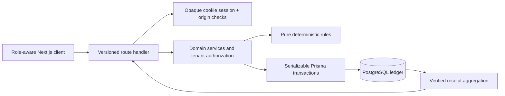

# Architecture

One Node process and PostgreSQL; no queue or external AI dependency. `src/server/auth.ts` validates sessions and applies persistent rate limits. The API rejects cross-origin mutations, validates envelopes, maps errors and removes internals. `service.ts` owns state changes and audit writes; `matching.ts` has no database or model dependency. Client components render and call APIs; they cannot authorize transitions.

Acceptance uses serializable transactions with bounded retries and a conditional OPEN/non-expired update. PostgreSQL's partial unique index is a second line of defense against multiple accepted offers. Unique pickup-per-lot and actor/key idempotency records bound retries. Handover verification and finalization are independent transactions with separate actors; only finalization creates a verified ledger entry.

Expiration reconciles on authenticated API requests and through `npm run reconcile` for scheduled maintenance. Every acceptance/proof path also checks the server-time boundary, so no worker lag grants extra acceptance time. Production should schedule reconciliation every minute. No external route/LLM/email adapter is activated; their absence is explicit.

The UI uses shared role-aware navigation, operational cards and accessible forms. Pages are client-driven against the same API used by tests. List APIs return deterministic bounded batches; impact uses a separate full-ledger aggregation. Reports now use PostgreSQL aggregation, including a scoped acceptance-time percentile. CSV exports fail explicitly above their documented bound.

## Tradeoffs

- Prisma 7 JavaScript PostgreSQL adapter avoids downloadable native query engines and preserves verified npm artifacts. PostgreSQL remains the source of transactional guarantees.
- Credential sessions are implemented directly rather than Auth.js: narrow same-origin credential flow, random revocable hashed sessions, no OAuth/provider infrastructure. This increases ownership of auth hardening; email confirmation/reset, session revocation and TOTP/recovery codes are implemented; real mail delivery and independent review remain launch gates.
- Plain CSS and native labeled controls replace Tailwind/shadcn to keep the initial dependency surface small. Lucide supplies icons.
- Compact module boundaries are adequate for the MVP; split service domains and console views as feature teams grow.
- Audit/receipt triggers prevent normal SQL mutation but cannot protect against a database superuser. Production uses a restricted database role and independent backups.

## Hardening service boundaries

`accounts.ts` owns token lifecycle, password/session management and MFA; `crypto.ts` provides authenticated encryption and RFC-tested TOTP. `operations.ts` owns team/settings/disputes/policy/export operations. `notifications.ts` emits inbox records within domain transactions; `mail.ts` owns encrypted outbox transport and retries. `readiness.ts` separates configuration/database inspection from public readiness responses. Production pages use `proxy.ts` request nonces and dynamic rendering. No new microservice is required; `npm run worker` runs maintenance/mail delivery against the same database.

Expiry processing is bounded and uses a database advisory lock; concurrent request-triggered maintenance skips when another process owns the lock. Every acceptance/proof action independently checks time, so maintenance delay never authorizes an expired donation. Batch assignment returns independent outcomes. Team operations support many users in one organization; multi-organization account switching and road routing remain explicitly outside this release scope.
