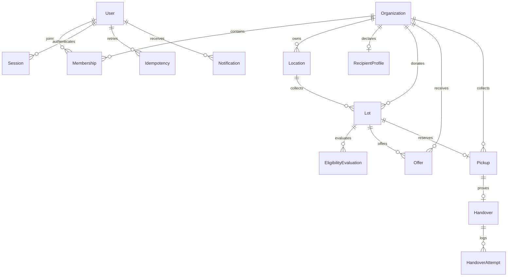

# Database

Schema: `prisma/schema.prisma`; reproducible SQL migration: `prisma/migrations/202610190001_foundation/migration.sql`.

AuditEvent is a separate append-only ledger with entity IDs, actor, tenant, correlation ID, UTC timestamp, state transition and JSON metadata. RateLimit implements atomic database-backed request counters. Notification is a reserved P1 data model; no delivery/inbox is advertised.

Decimal(12,3) quantities are positive, capped by API validation, and never convert between units. Database checks enforce valid states, quantity positivity and ordered windows. A partial unique index allows only one ACCEPTED offer per lot, plus a unique Pickup.lotId. Foreign keys bind users, organizations, locations and business records. Tenant/status/window indexes support operational reads. Session tokens are SHA-256 hashes of random 256-bit values. OTP is salted and hashed; plaintext appears only in the donor challenge response.

Migrations: `npm run db:generate`, `npm run db:migrate`, `npx prisma migrate status`. For a new schema change, create a new migration on a disposable development database; never edit a migration already deployed. Audit and verified handover update/delete triggers are intentional. Do not disable them to edit receipts: disputes need a separate append-only correction workflow (P1).

Local tests append uniquely named fixtures. They do not delete audit history. Use disposable test databases. Backups and restore verification are mandatory before real deployment; seed is never a production migration.

## Commercial-hardening migration

`202610190002_commercial_hardening` adds verified email timestamps; encrypted MFA enrollment/active secrets, last-used counter and recovery hashes; session creation timestamps; ActionToken with hashed unique token/expiry/consumption; encrypted MailOutbox with delivery status/leases/backoff; MatchingPolicy with sum-100 weight checks/version; scoped Dispute records with foreign keys. Notification now has a User foreign key.

The original migration remains unchanged. Custom foreign-key mappings are represented in Prisma so schema-diff checks agree with the deployed database. ActionToken, outbox and dispute states have SQL checks. Disputes append their own resolution/audits; they never alter a verified Handover. Operational aggregates use PostgreSQL groupBy/sum/count/percentile, not unbounded in-memory record scans. Runtime least-privilege grants are in scripts/runtime-role.sql and must be applied separately from schema ownership.

Encryption keys are not in the database or source archive. A local encrypted pg_dump restore rehearsal compared audit count, verified receipts, confirmed meal quantity and immutable-trigger presence. Production backups require separately managed keys, retention, offsite storage and owner-approved restore procedures.
