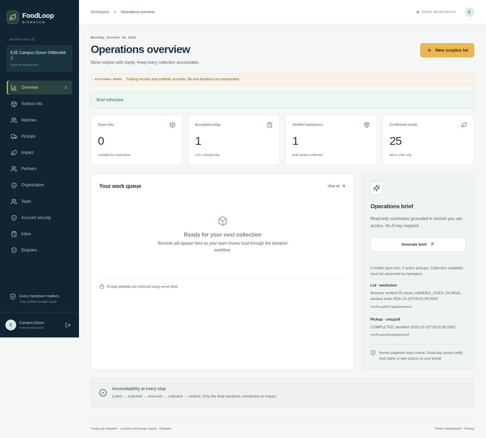
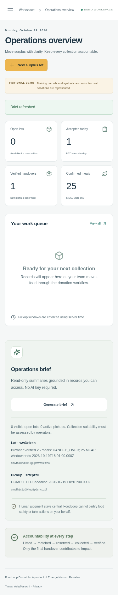

# Local setup and first donation

This guide uses fictional data on your own computer. Public launch prerequisites are in [RELEASE_READINESS.md](RELEASE_READINESS.md). Initial market: Pakistan. Product: FoodLoop Dispatch by Emerge Nexus.

## 1. Install prerequisites and clone

Install Git, Node.js 24 LTS (with npm), and Docker Desktop or Docker Engine with Compose. Start Docker. On Windows use WSL2 or a terminal compatible with your Node/Docker installation.

```bash
git clone https://github.com/Emerge-Nexus-SMIU/FoodLoop-Dispatch.git
cd FoodLoop-Dispatch
npm ci
npm run dev:configure
npm run db:generate
```

`dev:configure` creates `.env` from `.env.example` if absent, preserves configured values and generates the private encryption key. Do not upload `.env`. Package installation needs the npm registry; Prisma CLI needs `binaries.prisma.sh`. Keep certificate verification enabled.

## 2. Start PostgreSQL and prepare the database

```bash
docker compose up -d db
npm run db:migrate
npm run db:seed
```

Default local PostgreSQL listens on 127.0.0.1:5432. The example URL and Compose defaults match. If you change the local database password, update both `POSTGRES_PASSWORD` and `DATABASE_URL` in `.env` before creating the database. Changing the variable after a persistent database exists does not change its stored password automatically.

Without Docker, run `npm run db:local` in a separate persistent terminal, then migrate/seed as above. This alternative also uses port 5432; choose one database process. Another PostgreSQL installation can be used by setting DATABASE_URL to your dedicated local database.

Never seed an operational database. Demo seeding requires ALLOW_DEMO_SEED=true and is for local fixtures only. Do not delete database volumes to troubleshoot if they contain data you need.

## 3. Start application and background worker

Terminal A:

```bash
npm run dev
```

Terminal B, in the same repository:

```bash
npm run worker
```

Open http://localhost:3000 on your computer. Keep APP_ORIGIN equal to the browser origin; localhost and 127.0.0.1 are different origins. GET /api/health should return an OK response. The local readiness endpoint deliberately identifies this as a demo, not a commercial release.

Local mail uses private ignored files in `.local/mail`. After the worker processes a message, open its verification/reset/invitation link from the JSON file. File transport sends no external email. `npm run worker:once` runs a single maintenance/delivery batch.

## 4. Sign in and exercise the workflow

All fictional passwords: `DemoFoodLoop!2026`.

| Account                       | Purpose                                          |
| ----------------------------- | ------------------------------------------------ |
| admin@demo.foodloop.test      | Approvals and audit                              |
| donor@demo.foodloop.test      | Listings, matching, dispatch, final confirmation |
| recipient@demo.foodloop.test  | Offers and receiving confirmation                |
| recipient2@demo.foodloop.test | Alternative recipient                            |
| dispatcher@demo.foodloop.test | Transit and arrival                              |

Use separate browser profiles/private windows for simultaneous actors. Follow the [step-by-step demonstration](DEMO_SCRIPT.md). Create a fresh lot with a future pickup window; historical/expired fixtures are intentionally preserved. Only receiver confirmation followed by donor finalization creates verified impact. MEAL/KG/ITEM remain separate.




## 5. Validate your installation

```bash
npm run format:check
npm run lint
npm run typecheck
npm test
npm run test:integration
npx playwright install chromium
npm run test:e2e
npm run build
npm audit --audit-level=high
```

Use a disposable local test database: integration/browser tests append fictional records and may alter fixture state. Follow the [test plan](TEST_PLAN.md); never target real partner data. Linux browser installations may also require `npx playwright install --with-deps chromium` and OS package-install privileges. An existing Chromium can be selected with PLAYWRIGHT_CHROMIUM_PATH.

To test the built application locally, stop the dev server, set ALLOW_DEMO_LOGIN=true in local `.env`, keep APP_ORIGIN on loopback, then run `npm start`. Production mode otherwise rejects fixture logins. This explicit local exception does not qualify for public launch. Against a running local fixture app, `npm run smoke` creates a complete fictional donation. Expected evidence and current results: [QA report](QA_REPORT.md).

## 6. Alternative: full local Docker stack

After `npm ci` and `npm run dev:configure`:

```bash
docker compose up --build -d
docker compose run --rm -e ALLOW_DEMO_SEED=true migrate npm run db:seed
docker compose logs -f web worker
```

Stop any host dev server/database on ports 3000/5432 first. Compose runs migrations before the application/worker and is configured for a loopback demo. Its worker mailbox is in the `local_mail` Docker volume. `docker compose down` stops the stack while retaining data. Do not use `down -v` unless you deliberately intend to erase all local demo data.

## Troubleshooting

| Symptom                                | Check                                                                                                           |
| -------------------------------------- | --------------------------------------------------------------------------------------------------------------- |
| Cannot connect to database             | Docker is running, DB is healthy, port/URL/password agree; run `docker compose ps`                              |
| Address already in use                 | Stop the duplicate local service; do not start embedded and Docker PostgreSQL together                          |
| Prisma engine download fails           | Permit official binaries.prisma.sh and configure your trusted proxy CA; do not disable TLS/checksums            |
| Mutation returns origin error          | Browser URL matches APP_ORIGIN exactly; restart after editing configuration                                     |
| Verification link missing              | Worker running, MAIL_TRANSPORT=file; check private local mailbox or Docker volume                               |
| Demo login rejected in built app       | Explicit loopback ALLOW_DEMO_LOGIN=true; never enable on a public deployment                                    |
| Recipient not eligible                 | Refresh seed availability for the local demo; check verification, units, categories, capacity and pickup window |
| Database changes absent                | Run migrations and client generation; restart app after changing dependencies/schema                            |
| Commercial release check fails locally | Expected: fixtures, HTTP, missing real provider/legal/production controls intentionally produce NO_GO           |

## Publishing later

Do not reuse demo identities, default credentials or the local Compose security model publicly. Follow [deployment/rollback](DEPLOYMENT.md), [security](SECURITY.md), [Pakistan decisions](PAKISTAN_LAUNCH.md) and [release readiness](RELEASE_READINESS.md). Configure real transactional email, HTTPS, restricted runtime credentials, independent migration credentials, verified administrator MFA, secret custody, monitoring and backups. Support email and exact registered entity are pending owner decisions. Public legal pages are drafts.

The source includes no real email/provider/hosting credentials. Passing automated tests does not replace partner acceptance testing, legal approval or operational review.
