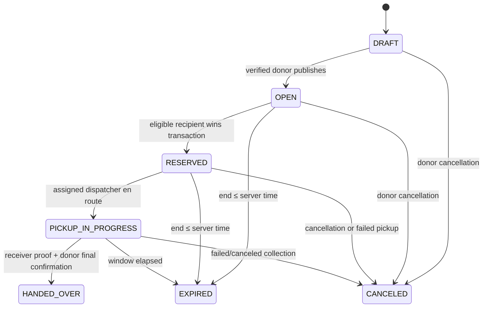

# State machines

Offer: PENDING → ACCEPTED / DECLINED / EXPIRED / SUPERSEDED. Winning acceptance supersedes competing pending offers. Expiry also invalidates an accepted offer if collection remains unverified.

Pickup: REQUESTED → SCHEDULED → ASSIGNED → EN_ROUTE → ARRIVED → COMPLETED. Donor schedules inside the window, then assigns a verified dispatcher. Only assigned dispatcher advances transit states. Donor or assigned dispatcher may fail/cancel with a reason. Expiration fails unfinished pickups. Reassignment allowed only while ASSIGNED; rescheduling only while SCHEDULED. No shortcuts, reopening, completed edits or silent impersonation.

Handover remains PENDING after challenge and receiver confirmation. Five-minute challenge lifetime is clamped to lot end. Donor confirms only after a distinct receiving actor has consumed proof and before pickup end. Code replay fails; identical successful idempotency retries return success. VERIFIED is immutable. Failed OTP attempts are durable, capped at five per handover (including regenerated codes). Lockout requires a separate future dispute workflow; it cannot be bypassed by regenerating codes.

There is no grace period. After expiration, create a fresh lot with a new declaration and identity rather than rewriting history.
